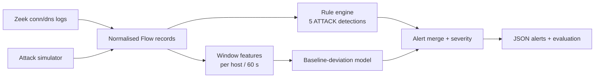

# SentinelFlow

**Hybrid network threat detection: behavioural rules + unsupervised ML, mapped to MITRE ATTACK.**

SentinelFlow ingests network flow records (Zeek logs or its built-in traffic simulator), detects
common attacker techniques with explainable rules, and adds a baseline-deviation ML layer that
catches high-volume anomalies the rules were not written for. It ships with a labelled attack
simulator, so detection quality is *measured*, not claimed.

> Defensive tooling only. It analyses flow metadata; it contains no exploit or attack code.
> The "attacks" are synthetic flow records.

## Architecture



## Detections

| Detection | MITRE ATTACK | Signal |
|---|---|---|
| Port scan | T1046 Network Service Discovery | Many distinct targets in a window with a high failed-connection ratio |
| Brute force | T1110 Brute Force | Burst of connections to one auth service (SSH/RDP/FTP/SMB) |
| C2 beaconing | T1071 Application Layer Protocol | Low coefficient of variation of inter-arrival times to one external host (jitter-tolerant) |
| DNS tunnelling | T1071.004 Application Layer Protocol: DNS | Many long, high-entropy labels under one parent domain |
| Exfiltration | T1041 Exfiltration Over C2 Channel | Large, strongly asymmetric outbound volume to one external host |
| ML anomaly | n/a (triage signal) | One-sided robust z-score of per-host window features vs. a clean baseline |

Thresholds live in `rules.DEFAULTS` and can be overridden per deployment. Legitimately periodic
traffic (NTP, DNS) is allow-listed from beaconing.

## Quick start

```bash
pip install -r requirements-dev.txt
pytest -q                          # 15 tests
python -m sentinelflow evaluate    # simulate -> train -> detect -> score

# or step by step
python -m sentinelflow simulate --no-attacks --seed 101 --out data/baseline.jsonl
python -m sentinelflow simulate --seed 1 --out data/traffic.jsonl
python -m sentinelflow train --baseline data/baseline.jsonl --model models/baseline.joblib
python -m sentinelflow detect --input data/traffic.jsonl --model models/baseline.joblib --out alerts.json

# real data: Zeek JSON logs
python -m sentinelflow ingest-zeek --conn conn.log --dns dns.log --out data/real.jsonl
python -m sentinelflow detect --input data/real.jsonl --model models/baseline.joblib
```

Docker: `docker build -t sentinelflow . && docker run --rm sentinelflow`

## Results

Simulated hour of enterprise traffic: 100 hosts, ~50k benign flows (web, DNS, SSH admins, legitimate
NTP, bulk downloads, a large backup upload) plus 5 injected attacks on 5 hosts. The ML model is
trained on a separate attack-free baseline. Host-level scoring:

| Layer | Hosts flagged | False positives | Precision | Recall | F1 |
|---|---|---|---|---|---|
| Rules only | 5 | 0 | 1.00 | 1.00 | 1.00 |
| ML only | 9 | 6 | 0.33 | 0.60 | 0.43 |
| Hybrid | 11 | 6 | 0.45 | 1.00 | 0.63 |

Per-attack: rules detect all five. The ML layer independently detects the port scan, DNS tunnel and
exfiltration (volumetric / statistical deviations) but **misses** the low-volume brute force and
the beacon, which only look abnormal in *time structure*, something per-window aggregates cannot
see. This is why the layers are complementary rather than redundant. ML alerts are emitted as
`medium` triage signals; rule alerts carry the severity and ATTACK mapping.

Reproduce: `python -m sentinelflow evaluate --out results.json` (output also in `docs/results.json`).

## Design notes and findings

- **Isolation Forest was tried first and rejected.** On this data it detected 0/5 attacks. It is
  symmetric (it flags unusually *quiet* windows as anomalous) and saturates on out-of-range values:
  a 500-flow scan window scored no higher than a legitimate bulk download already in the baseline.
  Security-relevant deviations are one-directional, so the default model is a one-sided robust
  z-score (median/MAD with a scale floor), which is also directly explainable (`top_features` in each
  alert). Isolation Forest remains available for comparison: `evaluate --ml-method iforest`.
- **Heavy-tailed features are log-compressed** so a handful of legitimate bulk transfers do not set
  the detection threshold for everyone.
- **Alerts are merged into incidents** (same rule/source/destination, adjacent windows) to avoid
  alert fatigue.

## Limitations (read before trusting the numbers)

- Evaluation is on **synthetic** data with attack patterns that I wrote and rules I tuned against
  them. Treat results as a regression harness, not as real-world accuracy. Next step is validation on
  public datasets (CIC-IDS2017, UNSW-NB15) and on captured lab traffic.
- ML false-positive rate (6 / 100 hosts per hour) would be too noisy to page on; it is designed for
  triage and enrichment.
- Adaptive adversaries can evade fixed thresholds (e.g. slower scans, randomised beacon jitter above
  the CV limit).
- Flow-level only; no payload inspection or TLS fingerprinting.

## Roadmap

- [ ] Validate on CIC-IDS2017 / UNSW-NB15 and report per-class metrics
- [ ] Temporal ML features (inter-arrival entropy) to close the beacon / brute-force gap
- [ ] Sigma-style YAML rule definitions and hot reload
- [ ] Streaming mode (Kafka / stdin) with sliding windows
- [ ] JA3/JA4 TLS fingerprint feature, ASN / threat-intel enrichment
- [ ] Alert dashboard (Grafana/Elastic export)

## Project layout

```
sentinelflow/
  rules.py       five ATTACK-mapped detections
  ml.py          window features + baseline-deviation / Isolation Forest models
  simulate.py    labelled traffic + attack generator
  ingest.py      Zeek conn.log / dns.log adapters
  alerts.py      alert model + incident merging
  evaluate.py    host-level precision / recall
  engine.py, cli.py
tests/           unit tests per rule + end-to-end regression
```

MIT licensed.
